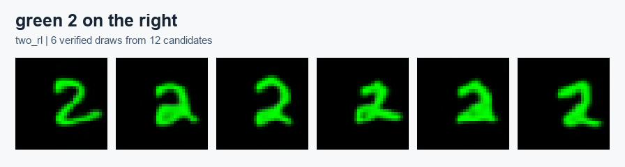

# MNIST Diffusion Post-Training

[项目展示 · GitHub Pages](https://wzihao-byte.github.io/mnist-diffusion-post-training/) · [Final stroke comparison](docs/assets/stroke-comparison.png) · [Release audit data](experiments/03-complete-digit-two/reports/release/audit.json)

An AI-assisted research project on controllable handwritten-digit generation. A small PyTorch diffusion model was trained with supervised fine-tuning, reward-based reinforcement learning, and on-policy distillation. Visual feedback then led to controlled ablations and a specialized model for drawing `2` with a visible start, turn, and tail.

**Project direction and visual review** by [@wzihao-byte](https://github.com/wzihao-byte). **Implementation and experiment execution** with Codex. The project lead identified concrete generation defects, selected the ablations to run, and narrowed the final acceptance criteria to the visible ends of the stroke.



## 迭代记录

| 阶段 | 我提出的观察或决定 | 如何验证 |
| --- | --- | --- |
| [01 跑通后训练](experiments/01-post-training/) | 要求基于公开数据实际运行 SFT、RL、OPD，并展示生成结果。 | 搭建 MNIST 有条件扩散实验。三组训练种子上，完整链路的数字、颜色、位置联合通过率由 SFT 的 83.89% 提升到 91.46%。 |
| [02 做字形消融](experiments/02-shape-ablation/) | 在对照图中指出「0」倾斜、「2」笔画不清。选定分辨率、困难样本、像素损失和奖励四项，要求逐项验证。 | 两组训练种子中，在原链路追加低学习率形状 RL。「0」直立通过率 47.6% → 95.8%，「2」可读且笔画足量 79.5% → 97.6%。 |
| [03 补齐数字 2](experiments/03-complete-digit-two/) | 指出总体指标提高后，仍能看到「2」的左侧缺笔或右下尾笔偏短。把目标收窄为两端都清楚可见。 | 用完整笔画数据继续 SFT、形状 RL，并复测 OPD。默认交付先检查左上、左下、右下三段，失败时重新采样。 |

## 最终结果

比较旧 32×32 检查点与专项模型，使用相同提示及噪声，各 1,152 张原始图。

| 指标 | 旧 32×32 | 专项 SFT + 形状 RL |
| --- | ---: | ---: |
| 左上起笔可见 | 72.6% | **98.5%** |
| 右下尾笔可见 | 87.8% | **97.8%** |
| 通过完整笔画检查和独立 OCR | 40.8% | **82.2%** |

追加专项 OPD 后完整通过率为 76.0%，因此保留形状 RL 作为默认权重。另用默认自动重抽路径测试 24 次请求，交付的 96 张均通过笔画检查并被独立 OCR 识别为「2」。完整通过率是重抽前的数字。模型与评估只覆盖本项目定义的 MNIST 手写字形、三种颜色和左右布局。

## 本地运行

使用 Python 3.12。每个阶段的目录包含源码、配置、模型权重和对应评估结果。

```bash
cd experiments/03-complete-digit-two
python3.12 -m venv .venv
source .venv/bin/activate
python -m pip install -r requirements.txt
python verify_two.py --prompt 'green 2 on the right' --count 6 --out demo/twos.png
```

复现训练的命令在各阶段 README。训练脚本从公开镜像获取并校验 MNIST。

[MNIST 数据](https://github.com/cvdfoundation/mnist) · [DDPM](https://arxiv.org/abs/2006.11239) · [DDPO](https://rl-diffusion.github.io/) · [DiffusionOPD](https://arxiv.org/abs/2605.15055)
